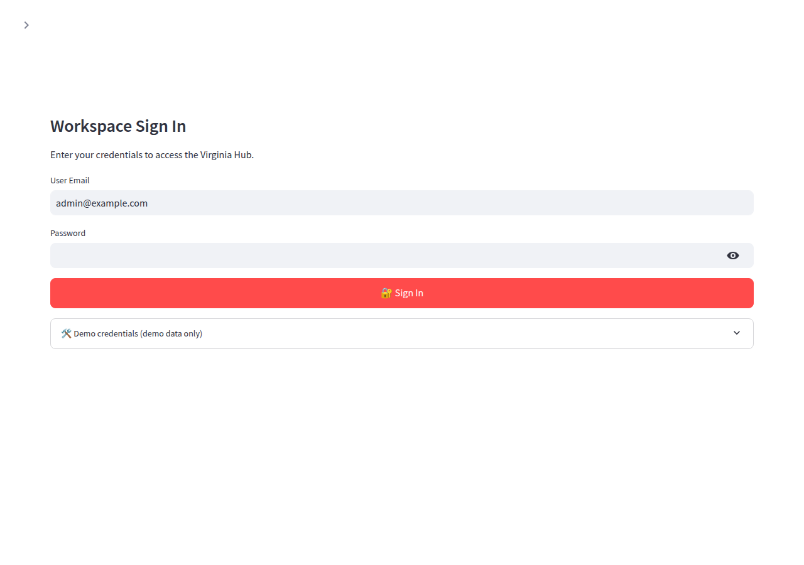
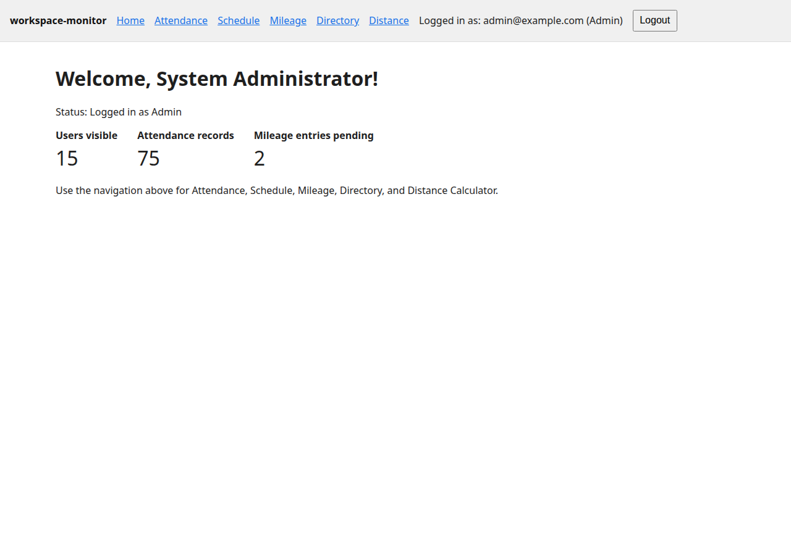
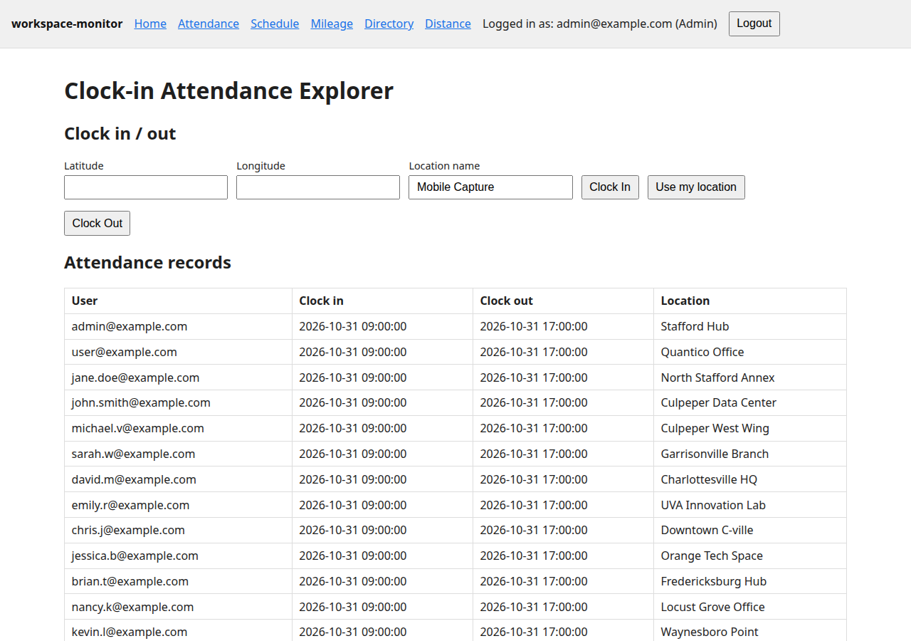
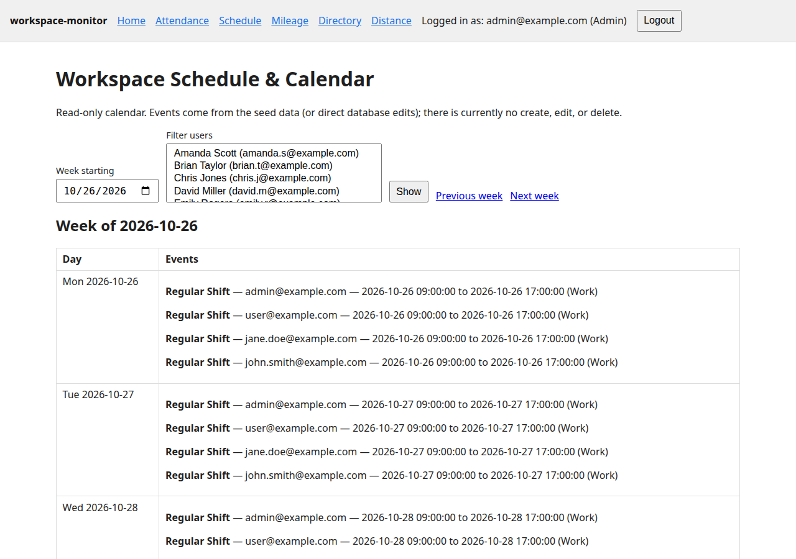
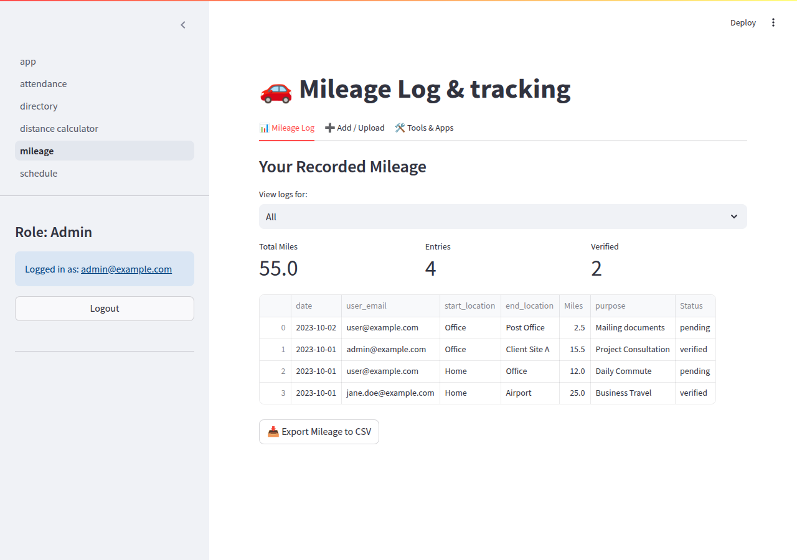
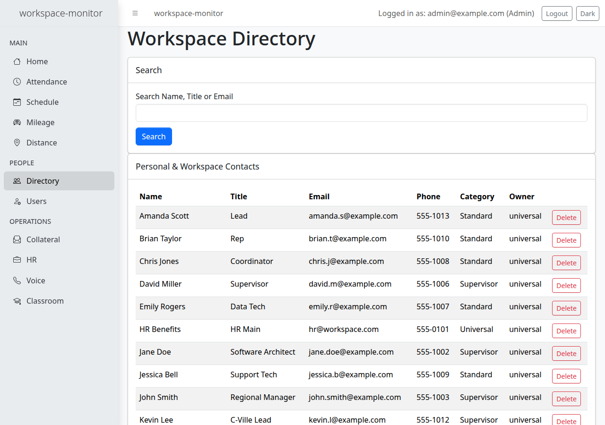
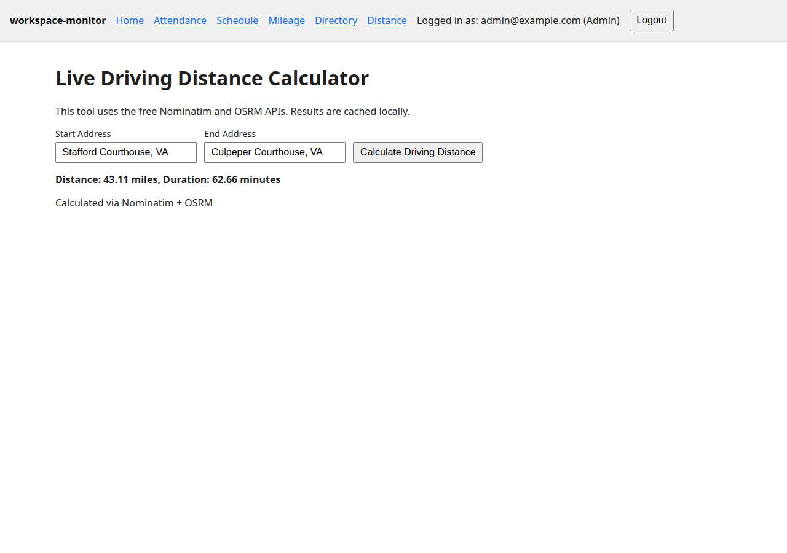
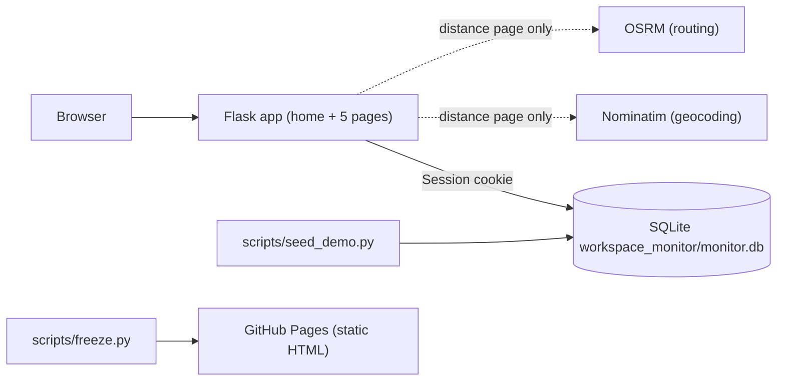
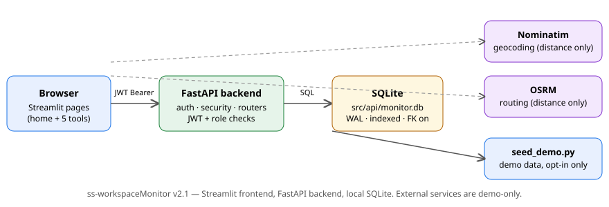

# workspace-monitor

[](LICENSE)
<!-- CI badge: add after the workflow has run green on main, e.g.
     [](https://github.com/enonymous1/workspace-monitor/actions/workflows/ci.yml) -->

A workspace dashboard for small teams: geolocation attendance, a schedule calendar, a mileage log with bulk upload, a directory, and a driving-distance calculator. Flask + Jinja2, one process, SQLite.

This is v3. It replaces the v2 FastAPI + Streamlit build with the same features, the same role rules, and the same demo dataset — in the Flask stack used by the author's other projects. If you are reading this after v2, the API endpoints and Streamlit pages are gone; everything below is the Flask app.

## Live preview (static freeze)

https://enonymous1.github.io/workspace-monitor/

GitHub Pages serves static files only, so the preview is a **real-HTML freeze**, not the live app: CI renders each page from the demo dataset and deploys it. Navigation and reading work — you can click through home, attendance, schedule, mileage, directory, and distance pages and read the demo data, including the Leaflet maps. Forms do not submit there: no login, clock-in/out, mileage add/upload, contact changes, or distance calculation. A banner on every frozen page says so. Run the app locally for the real thing.

One-time Pages setup: Settings → Pages → Build and deployment → Source: **GitHub Actions**. The freeze workflow (`pages-freeze.yml`) then publishes on every push to `main`.

Local freeze preview:

```powershell
python scripts/freeze.py --out freeze-site
python -m http.server --directory freeze-site 8000
```

## Features

- **Home dashboard** — real `COUNT(*)` totals (users visible, attendance records, pending mileage), not capped list lengths.
- **Attendance** — clock in/out with browser geolocation, history table, and a Leaflet map of clock-in locations. Clock-in is atomic: at most one open shift per user, enforced by a partial unique index as well as a pre-check.
- **Schedule** — server-rendered week view (Monday–Sunday, previous/next week, user filter for privileged users, optional start/end filters). Read-only: there is no create, edit, or delete yet.
- **Mileage** — manual entry, CSV/Excel bulk upload, and CSV export. Bulk upload validates all rows first, then inserts in one transaction — a bad row rejects the whole file, nothing is half-imported. New entries are always `pending`; `status` is never accepted from a form.
- **Directory** — searchable contacts. Admins may create/delete any contact; other users may only create/delete their own. Supervisors see all contacts but cannot manage others'.
- **Distance calculator** — Nominatim geocoding + OSRM routing, cached in the local database (repeated lookups never re-hit the public demo endpoints). Real example from the demo: Stafford Courthouse → Culpeper Courthouse, 43.11 miles, 62.66 minutes.
- **Roles** — Admin, Supervisor, Standard (case-insensitive, one enum). Admins and Supervisors see all users' rows; Standard users always see only their own, even if they pass another user's email in a filter. Mileage and contacts are always attributed to the session user for Standard users.
- **Theme** — follows your device's light/dark preference by default, with a Dark/Light button in the header to override it. Your choice is saved in the browser; with no saved choice it keeps following the system.

## Screenshots

Real output from the Flask app on the fictional demo dataset (not mockups).









## Prerequisites

- Python 3.11+
- No other services. The database is SQLite; Nominatim/OSRM are only used by the distance calculator.

## Installation

```powershell
git clone https://github.com/enonymous1/workspace-monitor.git
cd workspace-monitor
python -m venv .venv
.venv\Scripts\Activate.ps1
pip install -e .
```

## Local development

```powershell
# Seed the demo dataset (idempotent: a no-op if users already exist)
python scripts/seed_demo.py

# Run the app (http://127.0.0.1:5000)
python run_app.py
```

Demo login: `admin@example.com` / `Demo1234!` (also `jane.doe@example.com` Supervisor, `user@example.com` Standard). All 15 demo users share that password unless you set `WORKSPACE_MONITOR_DEMO_PASSWORD` before seeding. **Never seed demo data in production.**

Or, without seeding first, auto-seed on start (demo only):

```powershell
$env:WORKSPACE_MONITOR_AUTO_SEED = "1"
python run_app.py
```

## Configuration

| Variable | Default | Purpose |
| --- | --- | --- |
| `WORKSPACE_MONITOR_SECRET_KEY` | ephemeral per-process (with a warning) | Flask session secret. Set it for stable logins. |
| `WORKSPACE_MONITOR_DB` | `workspace_monitor/monitor.db` | SQLite path. Gitignored; never commit a `.db` file. |
| `WORKSPACE_MONITOR_PORT` | `5000` | Port for `run_app.py`. |
| `WORKSPACE_MONITOR_DEMO_PASSWORD` | `Demo1234!` | Password for all demo users, read at seed time. |
| `WORKSPACE_MONITOR_AUTO_SEED` | `0` | `1` seeds the demo dataset on start (demo only). |
| `WORKSPACE_MONITOR_LOGIN_MAX_FAILURES` / `WORKSPACE_MONITOR_LOGIN_WINDOW_SECONDS` | `5` / `900` | Failed-login rate limit per IP (15 minutes). |
| `WORKSPACE_MONITOR_API_TIMEOUT` | `10` | Seconds for Nominatim/OSRM requests. |

## Architecture



<!-- VISUAL 2 — exported SVG of the diagram above, for docs/. -->


Layout: `workspace_monitor/` is a top-level package (no `sys.path` hacks) — `create_app` factory in `__init__.py`, one blueprint per feature under `routes/`, Jinja templates under `templates/`, one stylesheet under `static/`, SQLite schema + deterministic seed in `database.py`, bcrypt auth + roles in `auth.py`, Nominatim/OSRM + route cache in `services.py`, and the static freeze in `scripts/freeze.py`.

Authentication is a server-side Flask session: the signed cookie holds only the email, every request re-checks the user in the database (so suspension and role changes take effect immediately), logout clears the session, and all POST forms carry a per-session CSRF token. There is no JWT and no token revocation table in v3.

## Deployment

`run_app.py` uses Flask's development server. For real use, run behind a WSGI server and a reverse proxy, for example:

```powershell
pip install waitress
waitress-serve --listen=127.0.0.1:5000 workspace_monitor:create_app
```

Then put a reverse proxy in front for HTTPS, and rate-limit `POST /login` there as well as in the app (the in-process limiter resets on restart and does not span workers).

### Before real use by a business

This is demo-grade, not a production HR system yet. Before real employees use it, close these gaps (they are the same in any stack):

- Set a real `WORKSPACE_MONITOR_SECRET_KEY` and never seed demo data in production.
- Add password reset, an audit log, and the mileage approval workflow (approve/reject).
- Add schedule create/edit/delete, if the business needs it.
- Decide and document a geolocation consent and retention policy — clock-in locations are stored indefinitely today.
- Back up the SQLite file, and decide who may export mileage/directory data.
- Do not rely on Nominatim/OSRM demo endpoints as a production routing dependency; they have a usage policy (roughly 1 request/second).

## Tests

```powershell
pip install -e ".[test]"
pip install ruff==0.8.4
ruff check workspace_monitor tests scripts run_app.py
ruff format --check workspace_monitor tests scripts run_app.py
python -m pytest -q
```

Tests use a throwaway Flask app and database per test (21 tests): login/logout, role visibility, clock-in/out and double clock-in, mileage attribution and all-or-nothing bulk upload, directory permissions, distance caching (with mocked Nominatim/OSRM), CSRF, rate limiting, suspension, seed counts, the freeze build, and version agreement. CI runs the same gates on Python 3.11 and 3.12, plus a freeze check.

## Known limitations

- Schedule is read-only; mileage has no approve/reject workflow; there is no password reset or audit log yet.
- No database migrations (Alembic) yet: schema changes are `CREATE TABLE IF NOT EXISTS` only.
- The in-process login rate limiter resets on restart; production deployments need proxy-level limiting too.
- Maps need internet (Leaflet + OpenStreetMap tiles from CDNs); without it the map area is grey but the tables still work.
- Distance routing depends on public Nominatim/OSRM demo endpoints.

## License

MIT — see [LICENSE](LICENSE).
